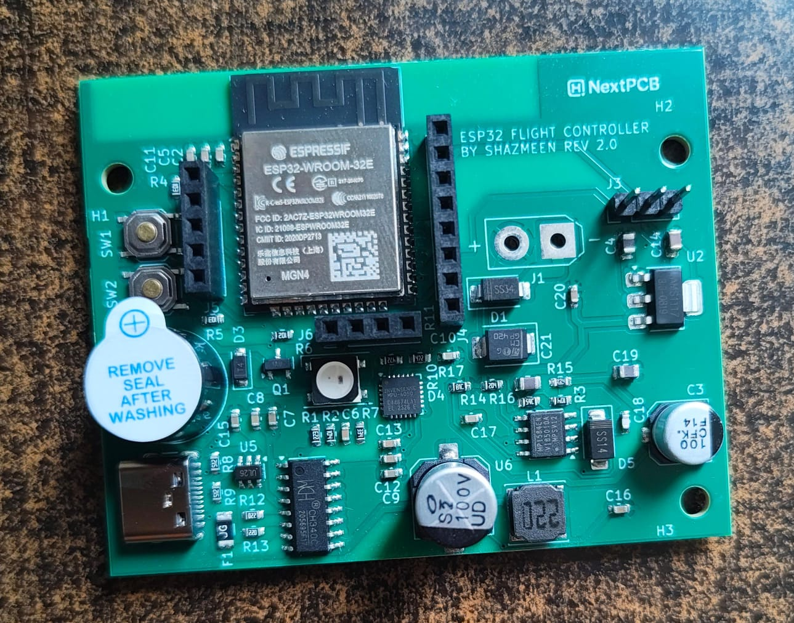
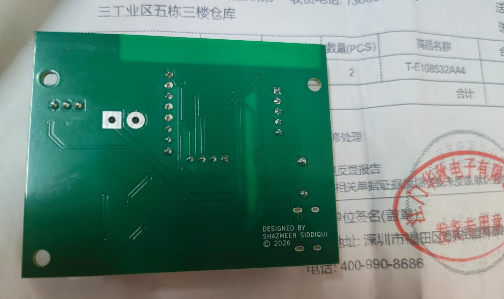
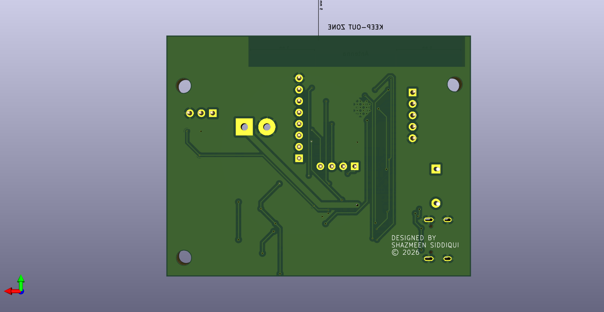

# ESP32 Flight Controller — Rev 2

The manufactured revision of a 4-layer ESP32 flight-controller PCB, designed in KiCad 8.


<p align="center">
  
</p>

The board is built around an **ESP32-WROOM-32E**. It takes a LiPo on an XT30, makes 5 V with an MP1584 and 3.3 V with an AMS1117, and brings out USB-C programming, an MPU-6050, GPS, and receiver headers. This directory is the Rev 2 hardware only: schematic, PCB, Gerbers, BOM, and photos. There is no flight firmware here.

Rev 1, the first design, is kept in a separate directory.

---

## Hardware

| | |
| --- | --- |
| MCU | ESP32-WROOM-32E (Wi-Fi and Bluetooth) |
| IMU | MPU-6050, I²C |
| USB | Type-C, CH340C USB-UART, USBLC6-2SC6 (U5) |
| Battery | LiPo on XT30 (J1) |
| 5 V | MP1584EN buck (U6) |
| 3.3 V | AMS1117-3.3 (U2) |
| Protection | SM6T24A (D4), Schottky diodes D1 and D5, 500 mA fuse (F1) |
| Status | WS2812B and an active buzzer |
| Buttons | BOOT (SW2) and RESET (SW1) |
| Board | 4-layer, 1.6 mm |
| CAD | KiCad 8 |

Power path:

```text
LiPo (XT30) → MP1584 → 5 V → AMS1117-3.3 → 3.3 V → ESP32
```

Copper is 1 oz (0.035 mm) on all four layers. The Gerbers name the inner layers `GND` and `POWER`.

### Connectors

| Ref | What it is |
| --- | --- |
| J1 | Battery, XT30 |
| J3 | iBUS / SBUS receiver, 1×3 |
| J4 | PWM receiver, 1×8 |
| J5 | Motor outputs, 1×5 |
| J6 | GPS UART, 1×4 |
| J9 | USB-C |
| — | ADC battery-voltage divider |

### What Rev 2 adds

Compared with the Rev 1 BOM, this revision adds:

- USBLC6-2SC6 (U5) on USB
- SM6T24A (D4) and a second Schottky (D5)
- the NextPCB logo footprint on the PCB

---

## Photos

<p align="center">
  
  
</p>

<p align="center">
  
  
</p>

<p align="center">
  
  
</p>

<p align="center">
  
  
</p>

---

## Files

```text
ESP32-Flight-Controller-Rev2
├── KiCad/
│   ├── flight_controller_rev2.kicad_pro
│   ├── flight_controller_rev2.kicad_sch
│   ├── flight_controller_rev2.kicad_pcb
│   ├── Connector.kicad_sym
│   └── logonextpcb.kicad_mod
├── Gerbers/                 copper, mask, paste, silk, edge, drill
├── BOM/flight_controller_bom.csv
├── Documentation/           drill map
├── Images/
├── LICENSE
└── README.md
```

Open `KiCad/flight_controller_rev2.kicad_pro` in KiCad 8. The files in `Gerbers/` are the set that was sent for manufacturing.

---

## Manufacturing support

<p align="center">
  <a href="https://www.nextpcb.com">
    
  </a>
</p>

Thank you to [NextPCB](https://www.nextpcb.com) for manufacturing this Rev 2 PCB. That support took the design from KiCad to a finished board and made the hands-on testing of this student project possible.

**Manufacturing partner:** [NextPCB](https://www.nextpcb.com)  
**Sponsored revision:** Rev 2

---

## Not on this board yet

- Barometer (BMP280 / BME280)
- Magnetometer
- Current sensor
- Blackbox logging
- CAN

---

## Author

**Shazmeen Wasi Siddiqui**

B.Tech, Electrical and Computer Engineering, Jamia Millia Islamia

## License

[MIT](LICENSE)
